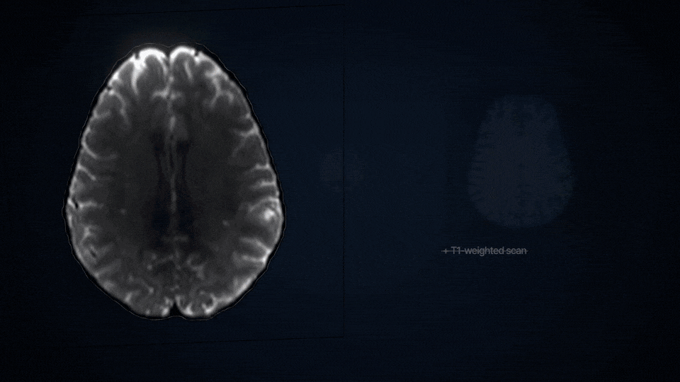

<div align="center">

# SlicerDSpace

**Diffusion MRI anatomical priors, microstructure and connectivity in 3D Slicer**

[](#technology-stack)
[](#installation)
[](#technology-stack)
[](#technology-stack)
[](#technology-stack)
[](#technology-stack)
[](#technology-stack)
[](#technology-stack)
[](#technology-stack)
[](#agent-skills)
[](https://chengjinlii.github.io/SlicerDSpace/)
[](LICENSE.txt)

[Overview](#overview) | [Video](#video) | [Technology](#technology-stack) | [Agent Skills](#agent-skills) | [Install](#installation) | [Quick Start](#quick-start) | [CLI](#command-line) | [Documentation](#documentation) | [Citation](#citation) | [中文](README.zh-CN.md)

[Project Website](https://chengjinlii.github.io/SlicerDSpace/) | [User Guides](docs/README.md) | [Release Status](#validation-and-release-status)

</div>

SlicerDSpace combines T1-weighted-image-free anatomical reconstruction,
microstructural mapping and white-matter analysis in one 3D Slicer module.
Choose your methods, prepare their environment and inspect the results in the
same scene.

---

<a id="video"></a>

<p align="center">
  <picture>
    <source media="(prefers-color-scheme: dark)" srcset="docs/site/assets/img/slicerdspace-wordmark-light.svg">
    <source media="(prefers-color-scheme: light)" srcset="docs/site/assets/img/slicerdspace-wordmark.svg">
    
  </picture>
</p>

[](docs/site/media/SlicerDSpace_promo_1080p.mp4)

[Watch the video (MP4, 1:12)](docs/site/media/SlicerDSpace_promo_1080p.mp4) ·
[Website player and transcript](https://chengjinlii.github.io/SlicerDSpace/#film)

---

## Overview

| Workflow | Methods and products |
| --- | --- |
| Input preparation | DICOM, NIfTI and NRRD/NHDR import; gradient checks, brain masking and optional DWI correction |
| Microstructure | DTI FA/MD/AD/RD; optional Free-water, NODDI, DKI and Python MK-Curve |
| Anatomical prior | DDSeg tissue labels, DDParcel regions, DDSurfer white/pial surfaces; optional cortical postprocessing |
| Tractography | DTI deterministic, UKF, CSD/ACT with SIFT2, and SAF short association fibres |
| Fiber bundles | Official WMQL queries, WMA atlas classification and TractCloud |
| Connectome | Streamline-count and scalar-weighted matrices; eligible SIFT2-weighted connectivity |

Key products load into Slicer as successful stages finish. Run-scoped loading
reuses scene nodes, while logs, parameters and QC stay with each run.
Optional [regional analysis](docs/setup/REGIONAL_ANALYSIS.md) reuses completed
maps, full tractograms and matrices for selected DDParcel regions. Search by
region name or label ID for scalar/tissue summaries, cortical morphology,
A-to-B streamline selection and regional connectivity. Detailed options stay
collapsed; reports and cohort CSV templates are included.

Shared preparation and compatible cached outputs are reused. Independent
microstructure models and separate subjects can run concurrently within the
configured resource budget. See [experiments](docs/setup/EXPERIMENTS.md) and
[measured optimizations](docs/release/PERFORMANCE_OPTIMIZATIONS.md).

---

## Technology Stack

| Layer | Components | Role |
| --- | --- | --- |
| Slicer interface | 3D Slicer, Qt/PythonQt, CTK, MRML | Product selection, native scene loading and result review |
| Scientific Python | Python, NumPy, SciPy, nibabel, SimpleITK | Images, geometry, numerical fitting and data exchange |
| Neural inference | PyTorch, DDSeg/DDParcel/DDSurfer models | Tissue, regional and surface reconstruction |
| Microstructure | DIPY, AMICO, Python MK-Curve | Tensor, free-water, neurite and kurtosis models |
| Diffusion tools | SlicerDMRI, optional UKFTractography, MRtrix3 and FSL | DTI preparation, tracking and selected correction routes |
| Optional backends | PNL CNN/ANTs, native FreeSurfer components, WMQL, WMA, TractCloud | Masking, cortical postprocessing and bundle identification |
| Automation | Python CLI, JSON run plans, batch runner, Agent Skill | Reproducible commands, parameter variants and cohort scheduling |

Dependencies follow the selected route. The default CSD/ACT route needs MRtrix3;
a DTI-only route with a supplied mask avoids PNL, FSL and FreeSurfer.
The explicit Slicer-native preset offers fewer external environments.
See the [capability/platform matrix](docs/setup/SUPPORT_MATRIX.md).

**Implementation origins:** DDSeg uses converted Python/PyTorch models; SAF
and MK-Curve are unofficial Python ports of author MATLAB methods. PNL CNN
masking calls the author's existing Python backend. Optional surface
postprocessing uses original FreeSurfer components and a personal activation
file. Details: [provenance](docs/architecture/IMPLEMENTATION_PROVENANCE.md) ·
[surface components](docs/setup/SURFACE_COMPONENTS.md).

---

## Agent Skills

Our **install-and-use Agent Skill** guides a local Agent through setup,
analysis and result review.

| Task | What the Skill covers |
| --- | --- |
| Install and enable | Find Slicer, stage the module, verify activation and prepare selected dependencies |
| Plan and run | Prepare inputs, choose algorithms and tracking/bundle sources, review plans and run requested analyses or batch experiments |
| Review and reuse | Inspect outputs, logs and QC; reuse compatible results and preserve unrelated scene nodes |

[Open the Skill](.agents/skills/slicerdspace/SKILL.md) ·
[Agent usage guide](.agents/skills/slicerdspace/references/usage.md) ·
[CLI templates](docs/setup/CLI_TEMPLATES.md) ·
[Algorithm Shell templates](.agents/skills/slicerdspace/references/shell_templates.md)

Prompts link directly to `SKILL.md`, the Agent's entry point. To install the Skill
in an Agent, copy the complete `slicerdspace` directory, including its references,
scripts and templates.

Copy this prompt into your local Agent:

```text
Read https://github.com/ChengjinLii/SlicerDSpace/blob/main/.agents/skills/slicerdspace/SKILL.md.
Install and enable SlicerDSpace in my local 3D Slicer.
Set up the required dependencies and download the corresponding model weights.
```

The Agent checks storage space and existing resources, waits for your choice,
and saves the selected path for GUI and CLI use. It downloads only the resources
needed by your selected analyses. Repository access is required while it is private;
you can provide an authorized local checkout if the Agent cannot open the URL.
Confirm licenses and restarts when requested.

**Use an existing installation.** Replace the input and output paths in this example:

```text
Read https://github.com/ChengjinLii/SlicerDSpace/blob/main/.agents/skills/slicerdspace/SKILL.md.
Use SlicerDSpace to run DDParcel brain parcellation, CSD/ACT tractography and structural connectome construction for /path/to/subject; save results to /path/to/results.
Show me the plan and wait for confirmation before running. Afterwards, summarize the outputs and QC findings.
```

Change the requested methods to suit your study; the [usage guide](.agents/skills/slicerdspace/references/usage.md)
and [CLI templates](docs/setup/CLI_TEMPLATES.md) cover other routes and batch execution.
The website guide bot provides navigation and curated answers; installation and
analysis run through your own Agent.

---

## Installation

### Stage The Extension

Use an authorized checkout while the repository is private. This lightweight
source installation omits the website and historical reports; a full checkout
retains development tests and research materials.

```bash
git clone --filter=blob:none --no-checkout --depth 1 https://github.com/ChengjinLii/SlicerDSpace.git
cd SlicerDSpace
git show HEAD:scripts/extension_runtime/runtime_checkout.txt | git sparse-checkout set --no-cone --stdin
git checkout
python3 scripts/stage_slicer_extension.py \
  --install-root ~/SlicerDSpace-extension --slicer-version Slicer-5.10 \
  --link-mode copy
```

For Slicer 5.10, add the expanded absolute path below in **Edit > Application
Settings > Modules > Additional module paths**, then restart:

```text
~/SlicerDSpace-extension/SlicerDSpace/lib/Slicer-5.10/qt-scripted-modules
```

Match `--slicer-version` to your installation. After a source update, restage
the extension and restart Slicer. More options: [download and installation guide](docs/setup/DOWNLOADS.md).

### Prepare The Selected Environment

In the module, select products, then open **Environment and installation >
Prepare selected analysis environment**. Confirm required tools and model terms;
restart if requested and select Prepare again to continue. SlicerDMRI,
PyTorch and the optional UKFTractography extension are prepared as needed.

Weights, templates and atlases live separately in [**SlicerDSpace-models**](https://github.com/ChengjinLii/SlicerDSpace-models).
The setup checks SHA256, caches downloads and saves paths. Existing installations,
offline models and repair are available under **More options**.
See [managed setup](docs/setup/MANAGED_SETUP.md) and
[resource terms](docs/assets/MODEL_ASSET_TERMS.md).

For explicit CLI surface-model preparation:

```bash
python3 scripts/download_model_assets.py --profile surface \
  --asset-root ~/SlicerDSpace-model-assets --source url \
  --source-id slicerdsurfer_models_git
```

For all anatomical model groups, use `scripts/download_model_assets.sh --profile core`.
Other profiles and offline import are documented in [model setup](docs/assets/MODEL_ASSETS.md).

---

## Quick Start

1. Open **Modules > Diffusion > SlicerDSpace** and choose English or Chinese.
2. Set **Subject root**, **Subject ID** and, optionally, an **Output directory**.
3. For a first DTI run, select only **Microstructure** and retain **DTI** in its **...** selector.
4. Prepare the selected environment, then click **Run SlicerDSpace**.
5. Inspect FA/MD in the scene and open **Results and QC** for the run's checks, logs and loading controls.

Prepared inputs use this layout:

```text
sub-01/
  input/
    data.nii.gz
    bvals
    bvecs
    nodif_brain_mask.nii.gz   # optional; supply or generate
```

The mask shares the DWI voxel grid. Gradients match the DWI volume count;
motion-corrected data use the corresponding rotated gradients.
DICOM/NRRD import is under **Advanced settings > Regions & input import**.
The [first-workflow tutorial](docs/setup/QUICKSTART.md) includes a synthetic installation check.

### Default Methods And Alternatives

| Part | Default | Other choices |
| --- | --- | --- |
| Missing brain mask | PNL diffusion CNN; valid supplied masks are reused | SynthStrip, MRtrix, DIPY median-Otsu, supplied mask only |
| Microstructure | DTI | Add Free-water, NODDI and/or DKI; select WLS/OLS or Python MK-Curve for DKI |
| Tractography | MRtrix3 CSD/ACT | DTI deterministic, UKF, SAF |
| Fiber bundles | Official WMQL multi-bundle queries | WMQL subset selection, WMA, TractCloud |

Use **...** beside Microstructure, Tractography and Fiber bundles to select one or
several methods. **Advanced settings** groups masking, model parameters,
performance, regional analysis/input import and experiments. Environment
installation remains separate.

UKF runs automatically through its installed extension and can feed WMA directly.
Multiple tracking methods produce separate `<run>__<backend>` variants.
The full quantitative tractogram is retained alongside a capped VTK display preview.

NODDI/DKI require eligible acquisitions. Inspect fit-validity masks, sparse
fiber bundles, alignment and anatomical priors before accepting results. Method details:
[microstructure](docs/setup/MICROSTRUCTURE.md) · [UKF](docs/setup/UKF.md) · [WMQL](docs/setup/WMQL.md).

---

## Command Line

Use Slicer's Python to check a prepared DTI route:

```bash
export SLICER="/path/to/Slicer"
"$SLICER" --launch PythonSlicer shared/run_subject_pipeline_cli.py \
  --no-user-config --strict-environment \
  --subject-root /path/to/sub-01 --subject-id sub-01 \
  --output-root /path/to/analysis/sub-01/dti --run-name dti \
  --targets validation,microstructure --microstructure-stages dti \
  --brain-mask-backend provided --doctor
```

Keep the same arguments and replace `--doctor` with `--plan` to inspect the plan,
then `--execute` to run. This example expects an existing reviewed mask.

The [CLI templates](docs/setup/CLI_TEMPLATES.md) cover imports, masking, anatomical priors,
all microstructure and tracking routes, explicit bundle sources, connectomes,
PowerShell and reports. [Experiments](docs/setup/EXPERIMENTS.md) covers
named parameter variants and concurrent subjects in both CLI and Advanced settings.
Start with one concurrency level and budget combined RAM/VRAM use.

---

## Documentation

| Task | Guide |
| --- | --- |
| First analysis | [Quick Start](docs/setup/QUICKSTART.md) |
| Commands and batch experiments | [CLI templates](docs/setup/CLI_TEMPLATES.md) · [Experiments](docs/setup/EXPERIMENTS.md) · [Example request](docs/setup/examples/dti_experiments.json) |
| Dependencies and platforms | [Support matrix](docs/setup/SUPPORT_MATRIX.md) · [Linux](docs/setup/LINUX_HPC.md) · [Windows](docs/setup/WINDOWS.md) · [macOS](docs/setup/MACOS.md) |
| Models and offline resources | [Assets](docs/assets/MODEL_ASSETS.md) · [Resource policy](docs/assets/EXTERNAL_RESOURCES.md) |
| Results and selected regions | [Result review](docs/setup/GUI_RESULT_REVIEW.md) · [Regional analysis](docs/setup/REGIONAL_ANALYSIS.md) |
| Settings and output layout | [Shared settings](docs/setup/USER_CONFIG.md) · [Output layout](docs/setup/OUTPUT_LAYOUT.md) |
| Manuscript and artwork | [LaTeX, PDF, figure sources and rebuild instructions](docs/paper/README.md) |
| Developer and release guides | [Repository layout](docs/architecture/REPOSITORY_LAYOUT.md) · [Extension readiness](docs/release/EXTENSION_READINESS.md) |

---

## Validation And Release Status

| Area | Current scope |
| --- | --- |
| Reference environment | Linux and Slicer 5.10; Windows/macOS availability is route-specific |
| Validation | Recorded Linux SDK/CPack, GUI and selected real-data workflows; coverage is tied to the documented revision and inputs |
| Distribution | Private pre-release; Extension Index entry remains a Tier 1 proposal |
| Licensing | BSD-3-Clause project code; third-party source and model assets retain separate terms and release gates |

Execution status, automatic QC and human review are recorded or assessed separately.
Review [validation records](docs/README.md#validation-records),
[platform support](docs/setup/SUPPORT_MATRIX.md) and
[release readiness](docs/release/EXTENSION_READINESS.md) for scope and outstanding checks.
The software is for research use, not clinical diagnosis.

Development checks require a full checkout:

```bash
make test-fast
python3 scripts/audit_slicer_extension_metadata.py --json
```

Validation is local during development. GitHub Actions and website publication
remain manual-only.

---

## Support

Report the Slicer version, OS, selected methods, failure message and redacted
logs. Remove subject identifiers and private paths before sharing.
Use the [result-review guide](docs/setup/GUI_RESULT_REVIEW.md) for run records
and the [managed-setup guide](docs/setup/MANAGED_SETUP.md) for dependency repair.

---

## Citation

Cite the software version through [CITATION.cff](CITATION.cff) and the methods
used in your analysis: [DDSurfer](https://doi.org/10.1002/advs.76596),
[DDSeg](https://doi.org/10.1016/j.neuroimage.2021.117934) and
[DDParcel](https://doi.org/10.1109/TMI.2023.3331691).
Additional integrated methods are listed in the [website bibliography](https://chengjinlii.github.io/SlicerDSpace/#cite).
The SlicerDSpace protocol manuscript is in preparation.

---

## License

Project code: **BSD-3-Clause**, [LICENSE.txt](LICENSE.txt).
Bundled components retain the terms in [THIRD_PARTY_NOTICES.md](THIRD_PARTY_NOTICES.md).
Weights, templates and subject data are governed separately; review
[asset permissions](docs/assets/MODEL_ASSET_TERMS.md) before redistribution.
