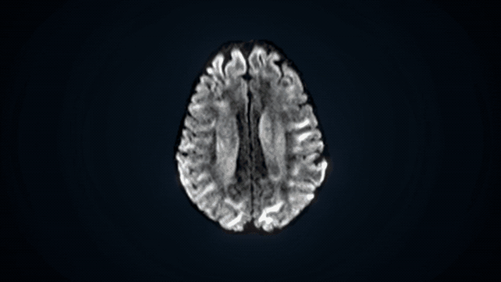

<div align="center">

# SlicerDDSurfer

**3D Slicer 中的扩散 MRI 解剖、微结构与连接分析**

[](#技术栈)
[](#安装)
[](#技术栈)
[](#技术栈)
[](#技术栈)
[](#技术栈)
[](#技术栈)
[](#技术栈)
[](#技术栈)
[](#agent-skills)
[](https://chengjinlii.github.io/SlicerDDSurfer/)
[](LICENSE.txt)

[概览](#概览) | [宣传视频](#宣传视频) | [技术栈](#技术栈) | [Agent Skills](#agent-skills) | [安装](#安装) | [快速开始](#快速开始) | [CLI](#命令行) | [文档](#文档) | [引用](#引用) | [English](README.md)

[项目网站](https://chengjinlii.github.io/SlicerDDSurfer/) | [使用指南](docs/README.zh-CN.md) | [发布状态](#验证与发布状态)

</div>

SlicerDDSurfer 将无需 T1 加权影像的解剖重建、微结构定量和白质分析整合到
一个 3D Slicer 模块中。选择算法、准备所需环境，即可在同一场景检查结果。
GUI、CLI 和 Agent Skill 共用工作流配置与执行记录。

**从扩散 MRI 出发，获得解剖、微结构与脑连接结果。**

科研软件 · 私有预发布 · 尚未进入官方 Extensions Catalog。

---

## 宣传视频

[](docs/site/media/SlicerDDSurfer_promo_1080p.mp4)

[观看完整视频（MP4，1 分 12 秒）](docs/site/media/SlicerDDSurfer_promo_1080p.mp4) ·
[网页播放器与字幕](https://chengjinlii.github.io/SlicerDDSurfer/#film)

---

## 概览

| 工作流 | 方法与结果 |
| --- | --- |
| 输入准备 | DICOM、NIfTI、NRRD/NHDR 导入；梯度检查、脑掩膜及可选 DWI 校正 |
| 微结构 | DTI FA/MD/AD/RD；可选 Free-water、NODDI、DKI 和 Python MK-Curve |
| 解剖重建 | DDSeg 组织分割、DDParcel 脑区、DDSurfer 白质/软脑膜表面及可选皮层后处理 |
| 纤维追踪 | DTI 确定性追踪、UKF、CSD/ACT 与 SIFT2、SAF 短程联络纤维 |
| 束分析 | 官方 WMQL 查询、WMA 图谱分类、TractCloud |
| 连接组 | 流线计数、标量加权矩阵及适用的 SIFT2 加权连接 |

成功阶段的关键结果自动加载到 Slicer，重复加载复用相应节点；
每次运行分别保存日志、参数与 QC。[可选脑区分析](docs/setup/REGIONAL_ANALYSIS.zh-CN.md)
复用已完成的参数图、完整流线和连接矩阵，导出所选 DDParcel 脑区的结果。

共用准备步骤与匹配的缓存可复用；算力允许时，可并发运行独立微结构模型或不同被试。
详见[批量实验](docs/setup/EXPERIMENTS.zh-CN.md)与[性能优化实测](docs/release/PERFORMANCE_OPTIMIZATIONS.zh-CN.md)。

---

## 技术栈

| 层次 | 组件 | 用途 |
| --- | --- | --- |
| Slicer 界面 | 3D Slicer、Qt/PythonQt、CTK、MRML | 算法选择、原生场景加载与结果检查 |
| 科学计算 | Python、NumPy、SciPy、nibabel、SimpleITK | 影像、几何、数值拟合与数据交换 |
| 神经网络推理 | PyTorch、DDSeg/DDParcel/DDSurfer 模型 | 组织、脑区与皮层表面重建 |
| 微结构 | DIPY、AMICO、Python MK-Curve | 张量、自由水、神经突和峰度模型 |
| 扩散工具 | SlicerDMRI，可选 UKFTractography、MRtrix3、FSL | DTI 准备、追踪及相应校正路线 |
| 可选后端 | PNL CNN/ANTs、原生 FreeSurfer 组件、WMQL、WMA、TractCloud | 掩膜、皮层后处理与束识别 |
| 自动化 | Python CLI、JSON 运行计划、批量调度器、Agent Skill | 命令执行、参数组合及多被试调度 |

依赖按路线配置：默认 CSD/ACT 需要 MRtrix3；提供已有掩膜的 DTI-only 路线
无需 PNL、FSL 或 FreeSurfer。也可明确选择 Slicer 原生轻量预设，以减少外部环境。
详见[能力与平台矩阵](docs/setup/SUPPORT_MATRIX.zh-CN.md)。

**实现来源：** DDSeg 使用转换后的 Python/PyTorch 模型；SAF、MK-Curve 为作者
MATLAB 方法的非官方 Python 移植；PNL CNN 掩膜调用作者已有的 Python 后端。
可选皮层后处理使用原生 FreeSurfer 组件及个人激活文件。
详见[实现来源](docs/architecture/IMPLEMENTATION_PROVENANCE.zh-CN.md)与[表面组件](docs/setup/SURFACE_COMPONENTS.zh-CN.md)。

---

## Agent Skills

我们提供 **安装与使用 Agent Skill**，让本地 Agent 按项目指南完成配置、分析和结果检查。

| 任务 | Skill 覆盖内容 |
| --- | --- |
| 安装与启用 | 定位 Slicer、部署插件、验证启用并准备所选依赖 |
| 规划与运行 | 准备输入、选择算法及追踪/束来源、检查计划，按请求执行分析或批量实验 |
| 检查与复用 | 检查输出、日志与 QC，复用匹配结果并保留无关场景节点 |

[查看 Skill](.agents/skills/slicerddsurfer-install/SKILL.md) ·
[Agent 使用指南](.agents/skills/slicerddsurfer-install/references/usage.md) ·
[命令行模板](docs/setup/CLI_TEMPLATES.zh-CN.md)

在已有访问权限的仓库中，可以对支持 `SKILL.md` 的 Agent 说：

```text
读取 .agents/skills/slicerddsurfer-install/SKILL.md，按需安装并启用
SlicerDDSurfer，为 /path/to/sub-01 规划 DTI 分析。
只准备所需依赖，执行前先给我查看运行计划。
```

Skill 由用户自己的 Agent 执行，下载、许可和重启按提示确认；
网页导览 Bot 负责导航和预设信息问答。

---

## 安装

### 部署插件

仓库暂为私有，需要已有访问权限。以下轻量源码安装不下载网站和历史报告；
开发测试与科研材料保留在完整仓库中。

```bash
git clone --filter=blob:none --no-checkout --depth 1 https://github.com/ChengjinLii/SlicerDDSurfer.git
cd SlicerDDSurfer
git show HEAD:scripts/extension_runtime/runtime_checkout.txt | git sparse-checkout set --no-cone --stdin
git checkout
python3 scripts/stage_slicer_extension.py \
  --install-root ~/SlicerDDSurfer-extension --slicer-version Slicer-5.10 \
  --link-mode copy
```

Slicer 5.10 用户在 **Edit > Application Settings > Modules > Additional module paths**
中加入以下路径（展开为绝对路径），然后重启：

```text
~/SlicerDDSurfer-extension/SlicerDDSurfer/lib/Slicer-5.10/qt-scripted-modules
```

`--slicer-version` 应与实际安装版本一致。更新源码后重新部署并重启 Slicer。
其他下载方式见[安装指南](docs/setup/DOWNLOADS.zh-CN.md)。

### 准备所选环境

进入模块，勾选产品，点击 **环境与安装 > 准备所选分析环境**。
确认所需工具和模型条款；如提示重启，重启后再点击准备以继续。
SlicerDMRI、PyTorch 及可选的 UKFTractography 扩展按路线准备。

权重、模板和图谱单独存放于 **SlicerDDSurfer-models**。配置过程校验 SHA256、
缓存下载并保存路径；**更多选项** 提供已有环境、离线模型和修复入口。
详见[自动配置](docs/setup/MANAGED_SETUP.zh-CN.md)与[资源条款](docs/assets/MODEL_ASSET_TERMS.md)。

需要显式使用 CLI 准备表面模型时：

```bash
python3 scripts/download_model_assets.py --profile surface \
  --asset-root ~/SlicerDDSurfer-model-assets --source url \
  --source-id slicerdsurfer_models_git
```

全套解剖模型资源可用 `scripts/download_model_assets.sh --profile core`。
其他 profile 及离线导入见[模型资源](docs/assets/MODEL_ASSETS.md)。

---

## 快速开始

1. 打开 **Modules > Diffusion > SlicerDDSurfer**，在标题栏选择中文或英文。
2. 设置 **Subject root**、**Subject ID**，按需另选 **Output directory**。
3. 首次 DTI 分析仅勾选 **Microstructure**，在旁边 **...** 中保留 **DTI**。
4. 准备所选环境后，点击 **Run SlicerDDSurfer**。
5. 在场景中检查 FA/MD，通过 **结果与 QC** 查看本次运行的检查、日志及加载操作。

准备好的输入采用以下结构：

```text
sub-01/
  input/
    data.nii.gz
    bvals
    bvecs
    nodif_brain_mask.nii.gz   # 可选；自行提供或生成
```

掩膜与 DWI 使用同一体素网格，梯度数量与 DWI 体积数一致；
运动校正后的 DWI 使用配套旋转梯度。DICOM/NRRD 导入位于 **高级设置 > 脑区与输入导入**。
[首次工作流教程](docs/setup/QUICKSTART.zh-CN.md)另含合成安装测试。

### 默认方法与替代选项

| 部分 | 默认 | 其他选项 |
| --- | --- | --- |
| 缺失脑掩膜 | PNL diffusion CNN；有效的已有掩膜直接复用 | SynthStrip、MRtrix、DIPY median-Otsu、仅用已有掩膜 |
| 微结构 | DTI | 加选 Free-water、NODDI、DKI；DKI 可选 WLS/OLS 或 Python MK-Curve |
| 纤维追踪 | MRtrix3 CSD/ACT | DTI 确定性追踪、UKF、SAF |
| 束分析 | 官方 WMQL 多束查询 | WMQL 束子集、WMA、TractCloud |

微结构、纤维追踪和束分析旁的 **...** 支持多选。
**高级设置** 按掩膜、模型参数、性能、脑区/输入导入和实验分类；环境安装单独管理。

UKF 通过已安装扩展自动运行，并可直接把结果传给 WMA。
多种追踪方法分别保存为 `<run>__<backend>` 变体。
完整定量流线保留，另生成限量 VTK 预览用于场景显示。

NODDI/DKI 需要适用的采集协议。接受结果前检查拟合有效性、低采样束、空间对齐与解剖结构。
方法说明：[微结构](docs/setup/MICROSTRUCTURE.zh-CN.md) · [UKF](docs/setup/UKF.zh-CN.md) · [WMQL](docs/setup/WMQL.zh-CN.md)。

---

## 命令行

使用 Slicer 的 Python 检查一条已准备的 DTI 路线：

```bash
export SLICER="/path/to/Slicer"
"$SLICER" --launch PythonSlicer shared/run_subject_pipeline_cli.py \
  --no-user-config --strict-environment \
  --subject-root /path/to/sub-01 --subject-id sub-01 \
  --output-root /path/to/analysis/sub-01/dti --run-name dti \
  --targets validation,microstructure --microstructure-stages dti \
  --brain-mask-backend provided --doctor
```

保持参数不变，将 `--doctor` 换成 `--plan` 查看计划，确认后换成 `--execute`。
此示例要求已有经检查的掩膜。

[完整 CLI 模板](docs/setup/CLI_TEMPLATES.zh-CN.md)覆盖导入、掩膜、解剖、各微结构与追踪路线、
束来源选择、连接组、PowerShell 和报告。[批量实验](docs/setup/EXPERIMENTS.zh-CN.md)
介绍 CLI 与高级设置中的命名参数组合及多被试并发。
建议先采用一个并发层级，并按总 RAM/显存需求配置。

---

## 文档

| 任务 | 入口 |
| --- | --- |
| 首次分析 | [快速开始](docs/setup/QUICKSTART.zh-CN.md) |
| 命令与批量实验 | [CLI 模板](docs/setup/CLI_TEMPLATES.zh-CN.md) · [实验指南](docs/setup/EXPERIMENTS.zh-CN.md) · [示例请求](docs/setup/examples/dti_experiments.json) |
| 依赖与平台 | [能力矩阵](docs/setup/SUPPORT_MATRIX.zh-CN.md) · [Linux](docs/setup/LINUX_HPC.md) · [Windows](docs/setup/WINDOWS.md) · [macOS](docs/setup/MACOS.md) |
| 模型与离线资源 | [资源配置](docs/assets/MODEL_ASSETS.md) · [资源策略](docs/assets/EXTERNAL_RESOURCES.zh-CN.md) |
| 结果与脑区 | [结果检查](docs/setup/GUI_RESULT_REVIEW.md) · [脑区分析](docs/setup/REGIONAL_ANALYSIS.zh-CN.md) |
| 设置与输出目录 | [共用配置](docs/setup/USER_CONFIG.md) · [输出目录](docs/setup/OUTPUT_LAYOUT.zh-CN.md) |
| 论文与插图 | [LaTeX、PDF、绘图素材与重建说明](docs/paper/README.zh-CN.md) |
| 开发与发布 | [源码结构](docs/architecture/REPOSITORY_LAYOUT.md) · [扩展准备状态](docs/release/EXTENSION_READINESS.zh-CN.md) |

---

## 验证与发布状态

| 范围 | 当前状态 |
| --- | --- |
| 参考环境 | Linux、Slicer 5.10；Windows/macOS 支持范围取决于所选路线 |
| 验证 | 已记录 Linux SDK/CPack、GUI 和部分真实数据工作流；范围对应具体版本和输入 |
| 分发 | 私有预发布；Extension Index 条目仍为 Tier 1 申请草稿 |
| 授权 | 项目代码采用 BSD-3-Clause；第三方源码和模型资源各自保留条款与发布门槛 |

执行状态、自动 QC 和人工审核分别记录或评估。
验证范围与待检查项见[验证记录](docs/README.zh-CN.md#历史验证记录)、
[平台支持](docs/setup/SUPPORT_MATRIX.zh-CN.md)及[发布准备](docs/release/EXTENSION_READINESS.zh-CN.md)。
本软件用于科研，不用于临床诊断。

开发检查需要完整仓库：

```bash
make test-fast
python3 scripts/audit_slicer_extension_metadata.py --json
```

开发阶段使用本地验证，GitHub Actions 与网站发布保持手动触发。

---

## 支持

反馈时提供 Slicer 版本、操作系统、所选算法、错误信息与脱敏日志，
分享前删除被试标识及私人路径。
运行记录见[结果检查指南](docs/setup/GUI_RESULT_REVIEW.md)，依赖修复见[自动配置指南](docs/setup/MANAGED_SETUP.zh-CN.md)。

---

## 引用

通过 [CITATION.cff](CITATION.cff) 引用所用软件版本，并引用实际使用的方法：
[DDSurfer](https://doi.org/10.1002/advs.76596)、
[DDSeg](https://doi.org/10.1016/j.neuroimage.2021.117934)、
[DDParcel](https://doi.org/10.1109/TMI.2023.3331691)。
其他集成方法见[主页参考文献](https://chengjinlii.github.io/SlicerDDSurfer/#cite)。
SlicerDDSurfer 协议论文仍在准备中。

---

## 许可证

项目代码采用 **BSD-3-Clause**，见 [LICENSE.txt](LICENSE.txt)。
第三方组件遵循 [THIRD_PARTY_NOTICES.md](THIRD_PARTY_NOTICES.md) 中各自的条款。
权重、模板与被试数据单独管理，再分发前请查阅[资源授权](docs/assets/MODEL_ASSET_TERMS.md)。
