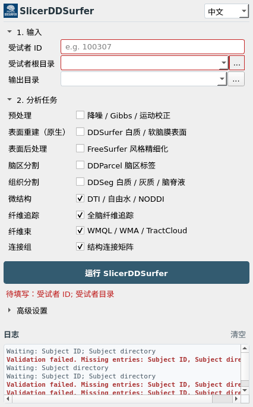

<div align="center">

# SlicerDDSurfer

**3D Slicer 中的扩散 MRI 分析工作流**

[](https://github.com/ChengjinLii/SlicerDDSurfer/actions/workflows/ci.yml)
[](LICENSE.txt)
[](https://www.slicer.org/)

[概览](#概览) | [安装](#安装) | [快速开始](#快速开始) | [文档](docs/README.zh-CN.md) | [验证状态](#验证与发布状态) | [引用](#引用) | [English](README.md)

</div>

SlicerDDSurfer 在一个 Slicer 模块中组织扩散 MRI 解剖重建、微结构定量和白质
连接分析。选择所需产品，执行可追溯工作流，再查看影像、QC 报告和运行记录。

**科研软件。** 当前为私有预发布项目，尚未通过官方 Extensions Catalog 分发。
任务完成不等于科学结果正确，也不构成临床诊断依据。

---

## 概览

<p align="center">
  
</p>

| 工作流 | 主要结果 | 主要前提 |
| --- | --- | --- |
| 输入准备 | DICOM/NIfTI/NRRD 导入、梯度检查、可选掩膜生成与预处理 | 对应导入或预处理后端 |
| 解剖重建 | DDSeg 组织分割、DDParcel 脑区、DDSurfer 白质与软脑膜表面 | 匹配的模型资源；所选路线需要 PyTorch/SlicerDMRI |
| 微结构分析 | DTI FA/MD、区域统计、Free-water、NODDI | 对应 Python 依赖；模型要求的多壳层采集 |
| 白质通路 | DTI/CSD、ACT/SIFT2、SAF、WMQL/WMA/TractCloud | 对应外部工具及资源 |
| 结构连接组 | 区域矩阵、场景检查、QC 与溯源记录 | 空间一致的分区和流线；SIFT2 路线还需权重 |

只安装**当前所选路线**需要的依赖，不要求首次安装全部外部工具。
MRtrix3、FSL、FreeSurfer 和高级白质束后端均为按需配置，不会静默安装。
详见[能力与平台矩阵](docs/setup/SUPPORT_MATRIX.zh-CN.md)。

---

## 安装

仓库保持私有，请使用已有访问权限的 checkout。以下是**源码 staging 安装**，
不是经过官方 SDK/CPack 验收的扩展包：

```bash
git clone https://github.com/ChengjinLii/SlicerDDSurfer.git
cd SlicerDDSurfer
python3 scripts/stage_slicer_extension.py \
  --install-root ~/SlicerDDSurfer-extension --link-mode copy --clean
```

在 **Edit > Application Settings > Modules** 中，将
`~/SlicerDDSurfer-extension/SlicerDDSurfer/lib/Slicer-5.10/qt-scripted-modules`
展开为绝对路径后加入 **Additional module paths**，重启 Slicer。
若使用其他 Slicer 版本，staging 时设置实际的 `--slicer-version`。
本地 GUI 验证使用 Slicer 5.10。更新代码后需重新 staging 并重启。

按路线从 Extension Manager 安装 **SlicerDMRI** 和 **PyTorch**。
模型与代码分开存放，在 **高级设置 > 环境与模型** 中设置可写的资源目录。
先阅读[资源使用与再分发状态](docs/assets/MODEL_ASSET_TERMS.md)，再下载所需 profile：

```bash
python3 scripts/download_model_assets.py --profile surface \
  --asset-root ~/SlicerDDSurfer-model-assets --source url \
  --source-id slicerdsurfer_models_git
```

完整解剖资源可用 `scripts/download_model_assets.sh --profile core`。
文件可下载、SHA256 正确，不代表已获得公开再分发授权。
详见[模型资源](docs/assets/MODEL_ASSETS.md)与[依赖设置](docs/assets/DEPENDENCY_SETUP_WORKFLOW.md)。

---

## 快速开始

1. 在模块选择器打开 **SlicerDDSurfer**，在标题栏选择中文或英文。
2. 填写 **Subject ID**、**Subject root**，可另选 **Output directory**。
3. 仅勾选本次需要的分析产品。
4. 展开 **高级设置**，设置分析路线、依赖和模型；运行前检查环境。
5. 点击 **Run SlicerDDSurfer**。输入不全会显示红色提示，按日志修正后重试。
6. 在 **高级设置 > 结果与 QC** 选择本次运行，加载声明的结果并检查 QC 报告。

默认界面不显示 Beginner 区，也不自动弹出首次向导。
DICOM/NRRD 等格式转换位于 **高级设置 > 输入导入 / 转换**；
已经准备好的输入无需重复转换。

```text
sub-01/
  input/
    data.nii.gz
    bvals
    bvecs
    nodif_brain_mask.nii.gz   # 可选；生成掩膜需要支持的后端
```

DWI 与掩膜须在同一体素网格，梯度数量须与 DWI 测量一致。
运动校正后的 DWI 必须配套旋转更新后的梯度。
[最小 DTI 教程](docs/setup/QUICKSTART.zh-CN.md)包含明确标识的合成安装测试；
合成数据不是人体科研示例。

---

## 文档

| 任务 | 入口 |
| --- | --- |
| 首次工作流 | [快速开始](docs/setup/QUICKSTART.zh-CN.md) |
| 平台与依赖 | [能力矩阵](docs/setup/SUPPORT_MATRIX.zh-CN.md) · [Linux](docs/setup/LINUX_HPC.md) · [Windows](docs/setup/WINDOWS.md) · [macOS](docs/setup/MACOS.md) |
| 模型资源 | [资源配置](docs/assets/MODEL_ASSETS.md) · [授权状态](docs/assets/MODEL_ASSET_TERMS.md) |
| 结果、取消和 QC | [结果检查](docs/setup/GUI_RESULT_REVIEW.md) |
| GUI/CLI 共用配置 | [配置](docs/setup/USER_CONFIG.md) |
| 源码组织 | [目录结构](docs/architecture/REPOSITORY_LAYOUT.md) |
| 维护者发布验收 | [扩展准备状态](docs/release/EXTENSION_READINESS.zh-CN.md) · [发布流程](docs/release/RELEASE.md) |

只检查环境，不执行算法：

```bash
python3 run_subject_pipeline.py --subject-root /path/to/sub-01 \
  --targets validation,microstructure --microstructure-stages dti --doctor
```

将 `--doctor` 换成 `--plan` 可保存运行计划。
需要 Slicer CLI 模块的执行路线必须使用 Slicer 或其 `PythonSlicer`。

---

## 验证与发布状态

Linux 真实数据与 GUI 验证见[验收记录](docs/release/SLICER_ACCEPTANCE_20261007.md)，
简洁界面另有 [UI 验证记录](docs/release/UI_SIMPLIFICATION_20261008.md)。
这些记录仅覆盖对应代码快照、路线和数据，不代表所有配置均已通过。

- CMake 与 staging 共用一份运行资源清单，安装包检查核对文件和源文件哈希。
- 快速 CI 和本地安装测试不能替代真实 SDK/CTest/CPack 构建。
- 尚未认证 Windows/macOS 原生科学工作流或三平台 SDK 构建。
- Extension Index JSON 是 **Tier 1 申请草稿**，不是官方已收录状态。
- 仓库公开、第三方源码许可补齐及模型再分发审查仍是独立发布门禁。

开发检查可运行 `make test-fast` 与
`python3 scripts/audit_slicer_extension_metadata.py --json`。
SDK 与独立干净安装验收详见[扩展准备状态](docs/release/EXTENSION_READINESS.zh-CN.md)。

---

## 支持

在高级设置的环境区收集诊断信息。提交问题时提供 Slicer 版本、操作系统、
所选路线、失败信息和脱敏日志，删除被试标识及私人路径。
报告默认保留本地，依赖与模型下载需要网络访问。

---

## 引用

SlicerDDSurfer 协议稿件仍在准备。使用 [CITATION.cff](CITATION.cff)
引用实际测试的软件版本，并引用本次使用的方法：
[DDSurfer](https://doi.org/10.1002/advs.76596)、
[DDSeg](https://doi.org/10.1016/j.neuroimage.2021.117934)、
[DDParcel](https://doi.org/10.1109/TMI.2023.3331691)。

---

## 许可证

项目代码采用 **BSD-3-Clause**：[LICENSE.txt](LICENSE.txt)；
保留同内容的 [LICENSE](LICENSE) 以兼容旧链接。
第三方源码单独适用 [THIRD_PARTY_NOTICES.md](THIRD_PARTY_NOTICES.md) 中的条款。
项目许可证不覆盖权重、模板和被试数据；部分组件授权仍待确认，
未形成书面许可记录前不要发布包含这些资产的公开归档。
